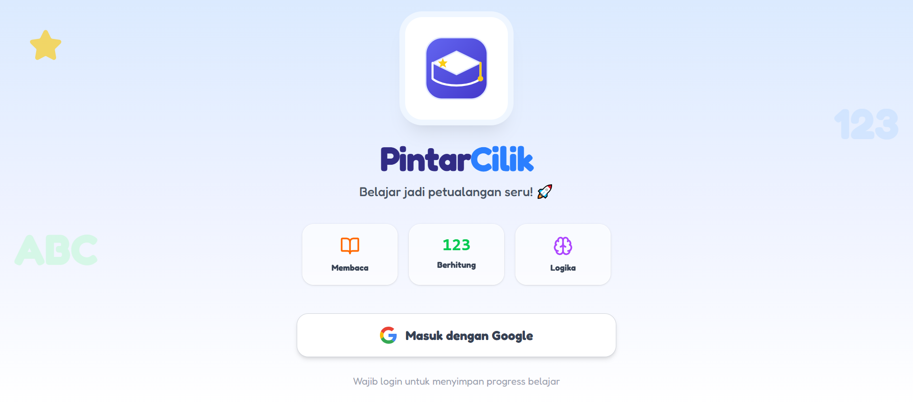

# PintarCilik

Game belajar untuk anak usia 4–6 tahun. Isinya membaca, berhitung, dan logika, dikemas sebagai permainan pendek yang bisa dimainkan di HP, tablet, atau komputer.

Situsnya bisa langsung dibuka di [calistung.ednasalam.com](https://calistung.ednasalam.com). Masuknya pakai akun Google.



## Isinya apa saja

Ada 10 permainan, dibagi dalam tiga kelompok:

- **Membaca** — Membaca & Kata, Huruf & Benda, Menulis Huruf (menelusuri huruf di layar), Susun Kata, Tebak dari Ciri.
- **Berhitung & Ukuran** — Berhitung & Angka (menghitung gambar, tambah, kurang), Besar & Kecil.
- **Logika & Bentuk** — Logika & Pola, Warna & Bentuk, Kartu Memori.

Selain permainan, ada **Cerita**: 7 cerita pendek yang bisa dibacakan dengan suara, buat dibaca bareng atau didengarkan sebelum tidur.

Setiap soal punya tombol suara yang membacakan instruksinya, karena anak usia segini memang belum lancar membaca. Ada dua level: Pemula dan Menengah.

## Buat orang tua

- Riwayat permainan tersimpan per akun. Di halaman Laporan ada jumlah permainan, rata-rata skor, dan skor per kelompok, plus saran kegiatan berikutnya. Laporan ini juga bisa dicetak atau disimpan sebagai PDF.
- Laporan, halaman Profil, dan ganti level dikunci gerbang orang tua (soal tambah sederhana), jadi anak tidak bisa membukanya sendiri.
- Di Profil, nama, umur, dan avatar anak bisa diubah. Ada juga pilihan teks lebih besar dan kurangi gerakan kalau anak lebih nyaman begitu.

Aplikasi ini bisa dipasang seperti aplikasi biasa (PWA) dan tetap bisa dibuka setelah pernah dimuat, walaupun koneksi sedang tidak ada.

## Menjalankan di komputer sendiri

```bash
git clone https://github.com/aqles/PintarCilik.git
cd PintarCilik
npm install
```

Buat file `.env` (contohnya ada di `.env.example`) berisi alamat proyek Supabase dan anon key-nya:

```env
SUPABASE_URL=https://your-project.supabase.co
SUPABASE_ANON_KEY=your-anon-key
```

Lalu:

```bash
npm run dev
```

Skema database ada di `supabase/schema.sql`. Jalankan file itu di SQL Editor Supabase untuk membuat tabel profil dan hasil permainan, lengkap dengan aturan supaya tiap akun hanya bisa mengakses datanya sendiri.

### Pakai PostgreSQL lain

Databasenya tidak harus di Supabase. Skema di atas isinya PostgreSQL biasa, jadi bisa dipasang di PostgreSQL mana pun. Tapi ada tiga hal yang perlu disesuaikan kalau pindah:

- **Login.** Di versi ini, masuknya pakai akun Google yang ditangani Supabase Auth. Kalau databasenya di tempat lain, loginnya perlu diganti atau tetap ditangani layanan auth terpisah.
- **Akses data.** Kode membaca dan menulis data lewat pustaka Supabase. Pindah database berarti lapisan ini ikut diganti, misalnya dengan API sendiri.
- **Aturan akses per akun.** Policy di skema memakai `auth.uid()`, itu cara Supabase mengenali akun yang sedang masuk. Di PostgreSQL lain, fungsi serupa perlu dibuat sendiri supaya tiap akun tetap hanya bisa mengakses datanya sendiri.

## Teknologi

React 19, Vite 6, TypeScript, Tailwind CSS 4, dan Supabase untuk login dan penyimpanan data.

Riwayat versi ada di dalam aplikasi, di bagian Catatan Pembaruan.

## Lisensi

MIT. Lihat berkas [LICENSE](LICENSE).

---

PintarCilik Project, 2025–2026.
